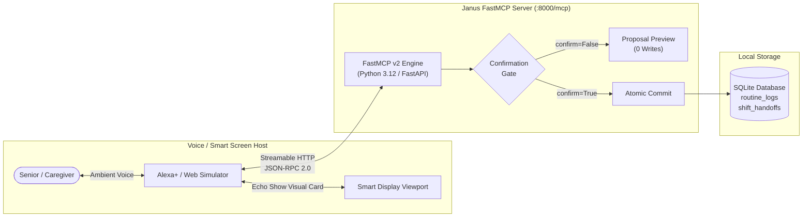

# Janus (ElderSync) — Non-Clinical Caregiver Synchronization for Alexa+

[](https://buildshipshape.devpost.com/)
[](https://spec.modelcontextprotocol.io/)
[](https://www.python.org/)
[](LICENSE)

> **Janus (ElderSync)** is a self-hosted Model Context Protocol (MCP) server for Alexa+ running over **FastMCP v2** and **Streamable HTTP**. It bridges the gap between aging seniors living independently and their distributed family caregivers by providing hands-free ambient voice logging on Echo devices, glanceable visual timeline cards for Echo Show smart screens, and auditable two-step confirmation shift handoffs.

---

## 🌟 The Problem & The Janus Solution

* **The Problem**: Aging seniors struggle with tiny touchscreens, app passwords, and complex mobile menus to log basic daily wellness routines (hydration, meals, vitamins, fresh air walks). At the same time, adult children and family caregivers suffer from anxious, fragmented text threads wondering: *"Did Mom drink water this afternoon? Has someone walked with her yet?"*
* **The Janus Solution**: Janus turns any Alexa+ enabled device into an ambient, zero-touch routine assistant. Seniors speak naturally (*"Alexa, tell Janus I finished my morning oatmeal and took my vitamins"*), while off-site family caregivers receive real-time, glanceable Echo Show visual timeline cards. Caregivers transferring shifts execute safe, verified handoffs using voice-confirmed safety gates.

---

## 🏗️ Architecture Overview



### Key Technical Attributes
* **FastMCP v2 over Streamable HTTP**: Implements MCP specification `2025-11-25` over stateless `POST /mcp`, bypassing long-lived SSE tunnel connection drops and meeting Alexa's $< 500\text{ ms}$ round-trip latency limit.
* **Two-Step Confirmation Gate**: Write-heavy tools enforce `confirm: bool = False` by default. When unconfirmed, the server returns a read-only proposal preview. Database commits require explicit voice confirmation (`confirm=True`).
* **Non-Clinical Safety Boundary**: Strictly restricted to lifestyle, wellness, hydration, and caregiver handoffs. Excludes clinical diagnosis, vitals triage, or prescription drug administration.
* **Zero Paid APIs**: Operates 100% locally with open-source Python libraries and SQLite.

---

## 🛠️ The 4 Core MCP Tools

| Tool Name | Type | Key Arguments | Confirmation Gate | Local Latency |
|---|---|---|:---:|:---:|
| `log_daily_routine` | Proposal Write | `senior_id`, `category` (enum: meal, hydration, vitamins, activity, wellness), `details`, `timestamp?` | **Yes** (Creates `pending_confirmation` proposal preview; 0 writes to `routine_logs`) | $< 15\text{ ms}$ |
| `get_caregiver_summary` | Read Query | `senior_id`, `date?` (YYYY-MM-DD) | **No** (Read-only timeline query) | $< 10\text{ ms}$ |
| `verify_routine_state` | Commit Gate | `confirm` (bool), `transaction_id?` (tx_...), `senior_id?`, `action_type?`, `payload?` | **Yes** (`confirm=False` returns preview; `confirm=True` atomically commits live proposal with idempotent replay) | $< 15\text{ ms}$ |
| `flag_missed_routine` | Read Query | `senior_id`, `routine_name`, `scheduled_time`, `urgency_level?` | **No** (Read-only ambient check) | $< 10\text{ ms}$ |

### Strict Two-Step Confirmation Gate Architecture
1. **Single-Writer Pattern**: Only `verify_routine_state(confirm=True, transaction_id=...)` can ever commit records into `routine_logs` or `shift_handoffs`.
2. **Proposals Ledger**: Write proposals are created with a 5-minute expiration (`expires_at = now + 5 min`) in the `proposals` table.
3. **Atomic & Idempotent**: Commits atomically execute `UPDATE proposals SET status='committed' WHERE transaction_id=? AND status='pending' AND expires_at > ?` and insert the target record in the same transaction. Replay of `confirm=True` returns `status: ALREADY_COMMITTED` with the existing `result_id` and performs 0 additional writes.
4. **Non-Clinical Boundary**: Category enum strictly enforced (`meal`, `hydration`, `vitamins`, `activity`, `wellness`). Clinical terms such as `medication` are rejected at the gate.

---

## 🚀 Quickstart & Installation

### 1. Prerequisites
* Python 3.12+
* Node.js (Optional, for MCP Inspector)

### 2. Clone and Install Dependencies
```bash
git clone https://github.com/<your-username>/janus-mcp.git
cd janus-mcp
pip install -r requirements.txt
```

### 3. Start the FastMCP Server
```bash
python src/janus/server.py
```
The server will bind to `http://127.0.0.1:8000/mcp` with Streamable HTTP enabled.

### 4. Launch the Alexa+ Web Simulator
Open `simulator/index.html` in your web browser:
* Test voice input via Web Speech API or use the typed text input bar.
* Click sample caregiver queries: *"Log 500ml water for Margaret"*, *"Show caregiver summary"*, or *"Record shift handoff"*.
* View real-time Echo Show visual card rendering.

---

## 🧪 Testing & Latency Benchmarks

Run the complete contract and latency test suite:
```bash
pytest tests/ -v
```
All tests validate:
1. Two-step confirmation gate invariants (zero writes on `confirm=False`).
2. Correct Pydantic schema validation for all 4 tools.
3. p95 local execution latency $< 100\text{ ms}$ (total round-trip $< 500\text{ ms}$).

---

## 📁 Repository Structure & Documentation

```
janus-mcp/
├── docs/
│   ├── GLOSSARY.md         # Canonical domain terminology
│   ├── DESIGN.md           # Architecture, SQLite schemas & tool specs
│   ├── PLAN.md             # 4-phase implementation roadmap
│   ├── DECISION_LOG.md     # Architecture Decision Records (ADR-001 to ADR-003)
│   └── LEARNINGS.md        # Technical platform constraints (<500ms latency, tunnels)
├── src/
│   └── janus/
│       ├── __init__.py
│       ├── server.py       # FastMCP server entrypoint (FastAPI /mcp)
│       ├── storage.py      # Local SQLite persistence engine
│       └── tools/          # Pydantic v2 tool schemas
│           ├── routine.py
│           └── handoff.py
├── simulator/              # Web-based Alexa+ smart screen simulator
│   ├── index.html
│   ├── app.js
│   └── style.css
├── tests/                  # Pytest contract & latency test suite
│   └── test_janus.py
├── .agents/                # AI Agent configurations
│   └── mcp_config.json
├── AGENTS.md               # AI development rules & safety boundaries
├── TASKS.md                # Live task tracker with checkable milestones
├── CHANGELOG.md            # Append-only change audit log
├── FRICTION_LOG.md         # Mandatory Devpost friction log (+10% bonus)
├── PRODUCT_FEEDBACK.md     # Product feedback questionnaire response
├── LICENSE                 # MIT License
├── requirements.txt        # Free open-source dependencies
└── README.md
```

---

## 🏆 Hackathon Submission Checklist

- [x] FastMCP v2 server over Streamable HTTP (`MCP spec 2025-11-25`)
- [x] 4 Core non-clinical MCP tools implemented with confirmation gate safety
- [x] Interactive Alexa+ Web Simulator with Echo Show visual cards
- [x] Pytest suite with sub-100 ms local latency verification
- [x] Mandatory [`FRICTION_LOG.md`](FRICTION_LOG.md) (+10% judging bonus)
- [x] Mandatory [`PRODUCT_FEEDBACK.md`](PRODUCT_FEEDBACK.md)
- [x] Standard [`LICENSE`](LICENSE) (MIT License) for public open-source submission
- [ ] 2.5-Minute Demonstration Video link added to Devpost
