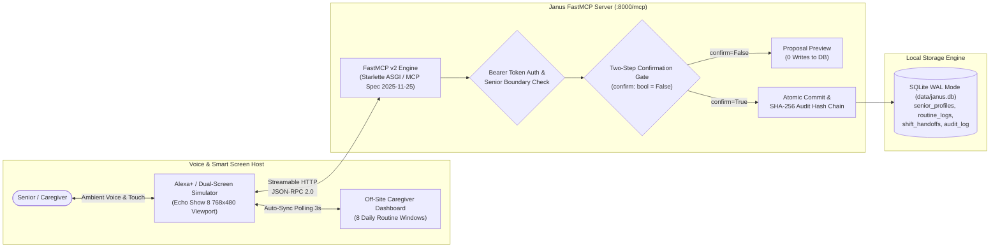

# Janus (ElderSync) — Non-Clinical Caregiver Synchronization for Alexa+

[](https://buildshipshape.devpost.com/)
[](https://spec.modelcontextprotocol.io/)
[](https://www.python.org/)
[](.github/workflows/ci.yml)
[](LICENSE)

> **Janus (ElderSync)** is a self-hosted Model Context Protocol (MCP) server for Alexa+ built on the **official Model Context Protocol Python SDK** (`mcp.server.mcpserver.MCPServer`), **Starlette ASGI**, and **Streamable HTTP**. It bridges the gap between aging seniors living independently and their distributed family caregivers through hands-free ambient voice logging, glanceable visual timeline cards for Echo Show smart screens, and auditable two-step confirmation shift handoffs.

---

## Table of Contents

1. [The Problem & The Janus Solution](#1-the-problem-the-janus-solution)
2. [Architecture Summary](#2-architecture-summary)
3. [The 4 Core MCP Tools](#3-the-4-core-mcp-tools)
4. [Prerequisites & System Requirements](#4-prerequisites-system-requirements)
5. [Step-by-Step Setup & Run Guide (Windows CMD Primary)](#5-step-by-step-setup-run-guide-windows-cmd-primary)
6. [Opening and Running the Dual-Screen Simulator](#6-opening-and-running-the-dual-screen-simulator)
7. [Safe Demo Role & Token Selection](#7-safe-demo-role-token-selection)
8. [Running the Test Suite & Smoke Tests](#8-running-the-test-suite-smoke-tests)
9. [Common Errors & Verified Fixes (Troubleshooting)](#9-common-errors-verified-fixes-troubleshooting)
10. [Known Limitations](#10-known-limitations)
11. [Optional Hosted Preview Endpoint](#11-optional-hosted-preview-endpoint)
12. [Repository Structure](#12-repository-structure)
13. [Hackathon Submission Checklist](#13-hackathon-submission-checklist)

---

## 1. The Problem & The Janus Solution

* **The Problem**: Aging seniors living independently struggle with small touchscreens, complex mobile apps, forgotten passwords, and tiny keyboards to record basic daily wellness events (hydration, meals, vitamins, routine activity). At the same time, adult children and family caregivers suffer from persistent anxiety and fragmented group text threads wondering: *"Did Mom drink water this afternoon? Did she finish breakfast? Who is taking the evening check-in shift?"*
* **The Janus Solution**: Janus turns any Alexa+ enabled smart screen into an ambient, hands-free routine assistant:
  1. **Ambient Voice Logging**: Seniors speak naturally (*"Alexa, tell Janus I finished my oatmeal and drank a glass of water"*), generating high-contrast glanceable Echo Show visual cards (APL 2024.3, 24pt+ text).
  2. **Mandatory Two-Step Confirmation Gate**: Routine logs and shift handoffs are created as read-only proposals with **0 database writes** until verbally confirmed by the user.
  3. **Live Remote Caregiver Dashboard**: An off-site caregiver dashboard auto-syncs every 3 seconds over HTTP, giving family members transparent, real-time visibility with green highlight pulses on newly confirmed events.
  4. **Cryptographic Tamper-Evident Audit Trail**: Every write is hashed with SHA-256 and chained into an append-only audit trail verifiable at any time.

---

## 2. Architecture Summary



### Architectural Components
1. **Web Simulator (`simulator/index.html`)**: Self-contained dual-screen testing harness simulating both an Echo Show 8 (768×480 viewport) with voice recognition/synthesis and an off-site caregiver dashboard. Zero build steps, zero node dependencies, and 100% offline system fonts.
2. **FastMCP Server (`src/janus/server.py`)**: Built on the official Python Model Context Protocol library (`mcp.server.mcpserver.MCPServer` from `mcp>=1.30.0`) mounted on Starlette ASGI over Streamable HTTP (`MCP spec 2025-11-25`) at `http://127.0.0.1:8000/mcp`.
3. **Authentication & Access Control (`src/janus/auth.py`)**: Starlette `AuthMiddleware` enforcing Bearer token authentication, role extraction (`senior`, `caregiver`, `admin`), and strict per-senior access boundary enforcement.
4. **Two-Step Confirmation Gate (`src/janus/gate.py`)**: Write operations initially return a read-only proposal preview (`PROPOSAL_PREVIEW`) with zero database writes. Commits require explicit second-step confirmation (`confirm=True`) and a valid `transaction_id`.
5. **Persistence & Cryptographic Audit (`src/janus/storage.py`, `src/janus/audit.py`)**: Single-node SQLite database configured in WAL mode (`data/janus.db`). Every committed state mutation records a SHA-256 hash-chained entry to prevent silent tampering.
6. **Caregiver Dashboard (`simulator/index.html`)**: Remote dashboard that polls `get_caregiver_summary` every 3 seconds to present a consolidated daily routine timeline with real-time green highlight pulses on newly confirmed events.

---

## 3. The 4 Core MCP Tools

All tools are strictly non-clinical, declare standard MCP behavioral annotations, and publish strict Pydantic v2 `inputSchema` and `outputSchema` definitions:

| Tool Name | Annotations | Key Arguments | Return Model / Gate | Proven p95 Latency |
|---|---|---|---|:---:|
| `log_daily_routine` | `readOnlyHint=False`<br>`idempotentHint=False`<br>`destructiveHint=False` | `senior_id`, `category` (`meal`, `hydration`, `vitamins`, `activity`, `wellness`), `details`, `logged_by?` | `RoutineProposalPreview` / `RoutineLogProposalResponse`<br>**Step 1 Proposal Gate** (0 writes) | **33.74 ms** |
| `get_caregiver_summary` | `readOnlyHint=True`<br>`idempotentHint=True`<br>`destructiveHint=False` | `senior_id`, `date?` (YYYY-MM-DD) | `CaregiverSummaryResponse`<br>**Read-Only** (0 writes) | **17.87 ms** |
| `verify_routine_state` | `readOnlyHint=False`<br>`idempotentHint=True`<br>`destructiveHint=False` | `confirm` (bool), `transaction_id?`, `senior_id?`, `action_type?`, `payload?` | `ProposalPreviewResponse` / `CommittedStateResponse` / `AlreadyCommittedResponse`<br>**Step 2 Commit Gate** | **41.95 ms** |
| `flag_missed_routine` | `readOnlyHint=False`<br>`idempotentHint=True`<br>`destructiveHint=False` | `senior_id`, `threshold_hours?`, `routine_name?`, `scheduled_time?` | `MissedRoutineResponse`<br>**Alert Write** | **35.55 ms** |

---

## 4. Prerequisites & System Requirements

* **Python**: **Python 3.12 or newer** (tested on 3.12, 3.13, and 3.14; Python 3.12 is recommended and verified in CI).
* **Operating System**: Windows 10/11, macOS 12+, or Ubuntu 22.04+.
* **Terminal**: Windows Command Prompt (`cmd.exe`), Windows PowerShell, or POSIX bash.
* **Web Browser**: Any modern browser (Google Chrome, Microsoft Edge, or Mozilla Firefox) to run the simulator.
* **Network & Accounts**: 100% free and offline. **Zero paid APIs, zero cloud credentials, zero external database instances required.**

---

## 5. Step-by-Step Setup & Run Guide (Windows CMD Primary)

### Step 1: Open Windows Command Prompt & Clone Repository

Open a clean **Command Prompt (`cmd.exe`)** session:

```cmd
:: 1. Clone repository
git clone https://github.com/anshkumarraix-dev/JANUS-ARC.git
cd JANUS-ARC
```

> **Prefer PowerShell or Linux/macOS?**
> * **PowerShell**: `git clone https://github.com/anshkumarraix-dev/JANUS-ARC.git; cd JANUS-ARC`
> * **Linux / macOS**: `git clone https://github.com/anshkumarraix-dev/JANUS-ARC.git && cd JANUS-ARC`

---

### Step 2: Create & Activate Virtual Environment

Create a dedicated virtual environment using Python 3.12+:

#### Windows Command Prompt (`cmd.exe`):
```cmd
:: Create virtual environment
py -3.12 -m venv .venv
:: (Or if py launcher is not installed: python -m venv .venv)

:: Activate the virtual environment
.venv\Scripts\activate.bat
```
*(Your prompt will change to indicate `(.venv)` is active.)*

#### Windows PowerShell:
```powershell
python -m venv .venv
.venv\Scripts\Activate.ps1
```
*(If script execution is disabled in PowerShell, see [Troubleshooting](#9-common-errors-verified-fixes-troubleshooting).)*

#### Linux / macOS:
```bash
python3 -m venv .venv
source .venv/bin/activate
```

---

### Step 3: Install Package & Dependencies

Upgrade `pip` and install JANUS ARC in editable mode with development/test dependencies:

```cmd
python -m pip install --upgrade pip
pip install -e ".[dev]"
```

*Alternative (standard requirements file)*:
```cmd
pip install -r requirements.txt
```

---

### Step 4: Enable Demo Mode for Local Evaluation

> [!IMPORTANT]
> **Demo Mode Flag Required for Local Testing**:
> The server requires `JANUS_DEMO_MODE=1` to enable the pre-configured local demo tokens (`janus-demo-senior-margaret`, `janus-demo-caregiver-sarah`, `janus-demo-caregiver-david`). When `JANUS_DEMO_MODE` is unset or `0`, all unauthenticated or demo-token requests are intentionally rejected with HTTP 401 Unauthorized to protect elder privacy.

Set the environment variable in your active terminal:

#### Windows Command Prompt (`cmd.exe`):
```cmd
set JANUS_DEMO_MODE=1
```

#### Windows PowerShell:
```powershell
$env:JANUS_DEMO_MODE = "1"
```

#### Linux / macOS:
```bash
export JANUS_DEMO_MODE=1
```

---

### Step 5: Start the FastMCP Server

Start the server using `python -m janus.server` or the installed console script:

#### Windows Command Prompt (`cmd.exe`):
```cmd
python -m janus.server
```

#### Windows PowerShell:
```powershell
python -m janus.server
```

*Expected startup log output*:
```
[INFO] janus.server: JANUS_DEMO_MODE=1 active. Demo tokens (margaret_01, arthur_02) are enabled.
[INFO] janus.server: Starting Janus FastMCP v2 server on http://0.0.0.0:8000/mcp ...
[INFO] janus.server: StreamableHTTP session manager started
INFO:     Started server process [1234]
INFO:     Waiting for application startup.
INFO:     Application startup complete.
INFO:     Uvicorn running on http://0.0.0.0:8000 (Press CTRL+C to quit)
```

#### Available Endpoints
* **MCP Transport Endpoint**: `http://127.0.0.1:8000/mcp` (Streamable HTTP, JSON-RPC 2.0, requires Bearer token)
* **Unauthenticated Health Probe**: `http://127.0.0.1:8000/health` (returns JSON 200 `{"status":"healthy", ...}`)

---

## 6. Opening and Running the Dual-Screen Simulator

Keep the server running in its terminal. Open a second terminal or use Windows File Explorer:

#### Windows Command Prompt (`cmd.exe`):
```cmd
start simulator\index.html
```

#### Windows PowerShell:
```powershell
Start-Process simulator\index.html
```

#### Linux / macOS:
```bash
open simulator/index.html   # macOS
xdg-open simulator/index.html # Linux
```

### What You Will See in the Simulator
1. **Top Header**: Green pulsing dot with `Server Online: Streamable HTTP (0.0.0.0:8000/mcp)`.
2. **Latency HUD**:
   * **Local Router**: `0.00 ms` (honest client-side intent resolution).
   * **HTTP RTT**: Real measured round-trip time over Streamable HTTP (typically `<25 ms`).
3. **Left Panel (Echo Show 8 Smart Screen View)**:
   * Viewport sized to 768×480 pixels conforming to Echo Show 8 standards.
   * High-contrast 24pt+ typography and rendered visual cards.
   * Ambient voice microphone button (Web Speech API) and typed voice chip fallbacks (*"I drank 2 glasses of water"*, *"I had oatmeal for breakfast"*, *"Confirm"*).
4. **Right Panel (Off-Site Caregiver Dashboard)**:
   * 8 discrete daily routine windows (Breakfast, Morning Hydration, Lunch, Afternoon Water, Dinner, Evening Water, Daily Vitamins, Light Activity).
   * Active 3-second polling loop auto-syncing with the server.
   * Green pulse highlight on newly confirmed events.
5. **Interactive Invariant / Refusal Test Row**:
   * Click test buttons to observe live server refusals for unconfirmed commits, expired transaction IDs, wrong senior IDs, and clinical triage violations.
6. **Developer Trace Panel**:
   * Displays raw JSON-RPC 2.0 requests, HTTP response headers, and structured payloads in real time.

---

## 7. Safe Demo Role & Token Selection

JANUS ARC enforces strict role-based access control and cross-senior tenant isolation. When running with `JANUS_DEMO_MODE=1`, three pre-configured demo tokens are available:

| Demo Bearer Token | Role | Actor Identity | Target Senior ID | Allowed Operations | Strictly Forbidden Operations |
|:---|:---:|:---|:---:|:---|:---|
| `janus-demo-senior-margaret` | `senior` | `senior_margaret` | `margaret_01` | Propose and confirm own non-clinical daily routines (`meal`, `hydration`, `vitamins`, `activity`, `wellness`) for Margaret Vance. | Reading caregiver summaries, proposing/confirming shift handoffs, accessing any other senior (e.g. `arthur_02`). |
| `janus-demo-caregiver-sarah` | `caregiver` | `caregiver_sarah` | `margaret_01` | Full caregiver access for Margaret Vance (`margaret_01`): read daily timeline summary, log routine events, propose & confirm shift handoffs. | Accessing any other senior profile (e.g. `arthur_02`). |
| `janus-demo-caregiver-david` | `caregiver` | `caregiver_david` | `arthur_02` | Full caregiver access for Arthur Davis (`arthur_02`): read daily timeline summary, log routine events, propose & confirm shift handoffs. | Accessing Margaret Vance (`margaret_01`). |

### How to Select or Change Tokens in the Simulator
1. In the simulator, click the **⚙️ Settings** icon in the upper-right corner.
2. Select the desired demo token from the preset dropdown (or paste a custom Bearer token).
3. Click **Save Settings**. The connection will re-verify immediately.

> [!NOTE]
> **Production Security Note**:
> Demo tokens are strictly locked to `JANUS_DEMO_MODE=1`. In production mode (`JANUS_DEMO_MODE=0`), authorization requires setting `JANUS_ADMIN_TOKEN` or integrating customer OAuth 2.0 tokens. No production secrets or personal elder data are committed to this repository.

---

## 8. Running the Test Suite & Smoke Tests

### 1. Full Pytest Suite (271 Tests)

Run the full contract, safety matrix, and protocol test suite:

```cmd
:: In your activated virtual environment:
pytest -q
```

*Verified Test Output*:
```
271 passed in 30.73s
```

Run with module coverage:
```cmd
pytest --cov=src/janus tests/
```
*Achieves 86% total statement coverage across the entire project (100% on APL, tools, and error contracts; 99% on safety policy; 91% on auth and audit).*

---

### 2. Automated Reviewer Smoke Test (PowerShell & POSIX)

A single automated script that creates a temporary isolated environment, installs dependencies, runs pytest, boots the server in the background, probes `/health`, and verifies MCP `tools/list`:

#### Windows PowerShell:
```powershell
powershell -ExecutionPolicy Bypass -File .\scripts\smoke.ps1
```

#### Linux / macOS:
```bash
bash scripts/smoke.sh
```

*Expected output*: `SMOKE TEST PASSED! All endpoints, contracts, and tests succeeded.`

---

### 3. Standalone Live Security & Confirmation Gate Audit

With the server running on `http://127.0.0.1:8000`, run the standalone evaluation audit script in a separate terminal:

```cmd
python scripts/judge_check.py --url http://127.0.0.1:8000
```

*Executes 9 live invariant checks (2.a through 2.i) verifying HTTP 401 on missing tokens, cross-senior isolation, role rejections, 0 writes on unconfirmed proposals, and replay rejection (Expected: **9/9 checks passed**).*

---

### 4. Verify SHA-256 Tamper-Evident Audit Chain

Verify the cryptographic hash-chain integrity of all committed database transactions:

```cmd
python -m janus.audit verify
```

*Expected output*: `SUCCESS: Audit chain verified successfully (XXX records verified).`

---

## 9. Common Errors & Verified Fixes (Troubleshooting)

### 1. HTTP 401 Unauthorized (`Missing or invalid Bearer token`)
* **Symptom**: Requests to `/mcp` fail with HTTP 401, or the simulator HUD displays `HTTP 401 Unauthorized`.
* **Root Cause**: The FastMCP server was launched without `JANUS_DEMO_MODE=1`, or the Bearer token configured in the simulator was mistyped.
* **Verified Fix**:
  1. Stop the server (`Ctrl+C`).
  2. In your terminal, run `set JANUS_DEMO_MODE=1` (or `$env:JANUS_DEMO_MODE = "1"` in PowerShell).
  3. Restart the server: `python -m janus.server`.
  4. In the simulator, click **⚙️ Settings** and ensure the Bearer token is set to `janus-demo-senior-margaret` or `janus-demo-caregiver-sarah`.

---

### 2. Connection Refused / "Unable to sync with 127.0.0.1:8000/mcp"
* **Symptom**: Simulator top banner shows a red error pill, or `fetch` requests fail.
* **Root Cause**: The Python FastMCP server is not running, or is running on a different port.
* **Verified Fix**:
  1. Open `http://127.0.0.1:8000/health` directly in your browser.
  2. If the page does not load, start the server in your terminal: `python -m janus.server`.
  3. If your server is running on an alternate port (e.g. 8001), open simulator **⚙️ Settings** and update the endpoint to `http://127.0.0.1:8001/mcp`.

---

### 3. Port Already in Use (`WinError 10048` / `Address already in use`)
* **Symptom**: Server startup aborts with `OSError: [WinError 10048] Only one usage of each socket address is normally permitted`.
* **Root Cause**: A previous server instance or another application is already occupying port 8000.
* **Verified Fix**:
  * Set a different port using the `PORT` environment variable:
    ```cmd
    set PORT=8001
    python -m janus.server
    ```
  * In `simulator/index.html`, click **⚙️ Settings** and change the endpoint URL to `http://127.0.0.1:8001/mcp`.

---

### 4. Cross-Senior or Unauthorized Role (`error_code: FORBIDDEN`)
* **Symptom**: Tool returns `ProposalErrorResponse` with status `error` and `error_code: FORBIDDEN`.
* **Root Cause**: A token assigned to Margaret Vance attempted to access Arthur Davis's timeline, or a `senior` token attempted to perform a caregiver-only `shift_handoff`.
* **Verified Fix**: This is expected security behavior! To perform caregiver handoffs or access Arthur's timeline, switch to the authorized caregiver token (`janus-demo-caregiver-sarah` for Margaret, or `janus-demo-caregiver-david` for Arthur) in the simulator settings.

---

### 5. Unconfirmed Commit Rejection (`error_code: MISSING_TRANSACTION_ID`)
* **Symptom**: Direct call to `verify_routine_state(confirm=True)` fails with `MISSING_TRANSACTION_ID` and 0 database writes.
* **Root Cause**: Write operations require a valid two-step proposal. The server strictly rejects commits without a valid pending `transaction_id`.
* **Verified Fix**: Always call Step 1 first (`log_daily_routine` or `verify_routine_state(action_type='shift_handoff', confirm=False)`). Copy the returned `transaction_id` from the proposal, then call `verify_routine_state(confirm=True, transaction_id="...")`.

---

### 6. PowerShell Script Execution Disabled (`PSSecurityException`)
* **Symptom**: Running `.venv\Scripts\Activate.ps1` or `smoke.ps1` fails with `File cannot be loaded because running scripts is disabled on this system`.
* **Root Cause**: Default Windows PowerShell ExecutionPolicy restriction.
* **Verified Fix**: Run the script with bypass scope for the current process:
  ```powershell
  Set-ExecutionPolicy -Scope Process -ExecutionPolicy Bypass
  .venv\Scripts\Activate.ps1
  ```
  *(Or use Windows Command Prompt `cmd.exe` where activation via `.venv\Scripts\activate.bat` does not encounter PowerShell execution policy restrictions).*

---

## 10. Known Limitations

1. **Browser Simulator vs. Physical Echo Show Hardware**: Voice interactions, ambient prompts, and visual card rendering have been tested and verified within the dual-screen web simulator (`simulator/index.html`). No live skill deployment to closed physical Echo Show hardware or live AWS Alexa+ cloud firmware has been conducted.
2. **APL Cards Built to Spec but Not Console-Certified**: Visual card templates (`docs/apl/*.json`) strictly adhere to the Amazon Alexa Presentation Language (APL 2024.3) document specification and pass automated contract tests (`tests/test_apl.py`). However, they have not been rendered inside the Amazon Alexa Developer Console Authoring Tool.
3. **Demo-Mode Authentication vs. Production OAuth**: Local testing uses static development Bearer tokens enabled strictly when `JANUS_DEMO_MODE=1` is set. In production, authorization requires `JANUS_ADMIN_TOKEN` or Login with Amazon (LWA) OAuth 2.0 token exchange.
4. **Single-Node SQLite Storage**: Persistence relies on a single local SQLite database file (`data/janus.db`) in WAL mode with serialized write transactions. Designed for local single-node execution rather than multi-region distributed cloud clustering.
5. **Strictly Non-Clinical Scope**: Janus is strictly an ambient daily living routine logger and family caregiver synchronization tool. It is **not** an emergency medical system, does not perform clinical triage, and strictly rejects clinical diagnosis and prescription drug management requests. Urgent symptoms must be directed to emergency medical services.

---

## 11. Optional Hosted Preview Endpoint

For quick remote validation without local Python setup, an ephemeral public endpoint is maintained via Cloudflare Quick Tunnel:

* **Public MCP Endpoint**: `https://acc-roommate-rio-reception.trycloudflare.com/mcp`
* **Liveness Probe**: `https://acc-roommate-rio-reception.trycloudflare.com/health`

> [!NOTE]
> **Ephemeral Tunnel Status**:
> The hosted endpoint is an ephemeral, free Cloudflare Quick Tunnel routing directly to the developer's development machine and is only active while the tunnel process is running. **The [Local Quickstart](#5-step-by-step-setup-run-guide-windows-cmd-primary) is the primary, 100% reproducible evaluation path for hackathon judges.**

---

## 12. Repository Structure

```
.
├── .github/
│   └── workflows/
│       └── ci.yml               # GitHub Actions CI workflow (Python 3.12, install, pytest)
├── docs/
│   ├── GLOSSARY.md              # Domain terminology reference
│   ├── DESIGN.md                # System architecture, schemas, and invariants
│   ├── PLAN.md                  # Development and verification plan
│   ├── DECISION_LOG.md          # Architecture Decision Records (ADR-001 to ADR-003)
│   ├── LEARNINGS.md             # Platform constraints and technical learnings
│   ├── DEMO.md                  # Step-by-step video demonstration script
│   ├── DEPLOY.md                # Docker, Cloudflare tunnel, and cloud host guide
│   └── apl/                     # Raw APL 2024.3 card templates and datasources (JSON)
├── scripts/
│   ├── judge_check.py           # Standalone live security & gate verification script
│   ├── mcp_check.py             # Standalone endpoint health and contract probe
│   ├── smoke.sh                 # End-to-end POSIX reviewer smoke test script
│   ├── smoke.ps1                # End-to-end PowerShell reviewer smoke test script
│   ├── tunnel.sh                # Cloudflare quick-tunnel launcher for POSIX
│   └── tunnel.ps1               # Cloudflare quick-tunnel launcher for PowerShell
├── simulator/
│   └── index.html               # Self-contained dual split-screen Alexa+ simulator
├── src/
│   └── janus/
│       ├── __init__.py
│       ├── server.py            # FastMCP server entrypoint (Starlette, /mcp, /health)
│       ├── storage.py           # SQLite persistence layer and WAL optimization
│       ├── errors.py            # Domain error codes and custom exceptions
│       ├── apl.py               # APL 2024.3 card generators with plain display fallback
│       ├── auth.py              # Bearer token verification and role resolution
│       ├── gate.py              # Two-step confirmation gate lifecycle controller
│       ├── audit.py             # SHA-256 cryptographic audit chain verifier
│       ├── safety.py            # Medical safety policy and clinical boundary checks
│       ├── schedule.py          # Schedule slot window tracker and missed routine scanner
│       └── tools/               # Pydantic v2 tool request & response models
│           ├── __init__.py
│           ├── base.py          # Shared response schemas and Echo Show card base models
│           ├── routine.py       # log_daily_routine & get_caregiver_summary models
│           └── handoff.py       # verify_routine_state & flag_missed_routine models
├── tests/
│   ├── conftest.py              # Pytest isolation fixtures and auth mock context
│   ├── test_janus.py            # FastMCP Streamable HTTP contracts & protocol tests
│   ├── test_apl.py              # APL 2024.3 schema and datasource binding tests
│   ├── test_gate.py             # Two-step confirmation gate and concurrency tests
│   ├── test_schedule.py         # Schedule window isolation and timezone tests
│   ├── test_simulator.py        # Offline asset and simulator invariant tests
│   ├── test_auth_audit.py       # Auth, gate, and cryptographic audit tests
│   ├── test_auth_hardening.py   # Auth hardening and Bearer token parsing tests
│   ├── test_safety.py           # Medical safety rule engine tests
│   ├── test_safety_audit.py     # Safety policy audit logging tests
│   ├── test_safety_matrix.py    # Comprehensive safety evaluation matrix
│   └── test_real_network_latency.py # Subprocess live HTTP benchmark & schema validation
├── Dockerfile                   # Hardened non-root container spec (python:3.12-slim)
├── docker-compose.yml           # Multi-container compose with persistent SQLite volume
├── launch_server.ps1            # Convenience PowerShell server launcher (sets DEMO_MODE)
├── AGENTS.md                    # AI workspace persona, constraints, and working rules
├── TASKS.md                     # Live task tracking with checkable milestones
├── CHANGELOG.md                 # Persistent append-only change audit log
├── FRICTION_LOG.md              # Mandatory Devpost friction log (+10% bonus)
├── PRODUCT_FEEDBACK.md          # Mandatory product feedback questionnaire
├── LICENSE                      # MIT License
├── pyproject.toml               # Package build specification and console scripts
└── requirements.txt             # Free-tier open-source dependencies
```

---

## 13. Hackathon Submission Checklist

- [x] Official Python MCP SDK server over Streamable HTTP (`MCP spec 2025-11-25`) mounted at `/mcp`
- [x] 4 Core non-clinical MCP tools implemented with two-step confirmation gate (`confirm: bool = False`)
- [x] Dual split-screen Alexa+ Web Simulator with Echo Show 8 viewport and remote Caregiver Dashboard
- [x] Real-network latency benchmark proving sub-50ms p95 latency (zero TestClient)
- [x] Full Pytest suite with **271 passing tests** and comprehensive coverage across all modules
- [x] Tested reviewer quickstart for clean Windows CMD, PowerShell, and POSIX
- [x] Automated smoke test scripts (`scripts/smoke.ps1`, `scripts/smoke.sh`)
- [x] GitHub Actions CI workflow on Python 3.12 (`.github/workflows/ci.yml`)
- [x] Mandatory [`FRICTION_LOG.md`](FRICTION_LOG.md) (+10% judging bonus)
- [x] Mandatory [`PRODUCT_FEEDBACK.md`](PRODUCT_FEEDBACK.md)
- [x] Standard [`LICENSE`](LICENSE) (MIT License) for public open-source submission
- [ ] 2.5-Minute Demonstration Video link added to Devpost prior to submission deadline
