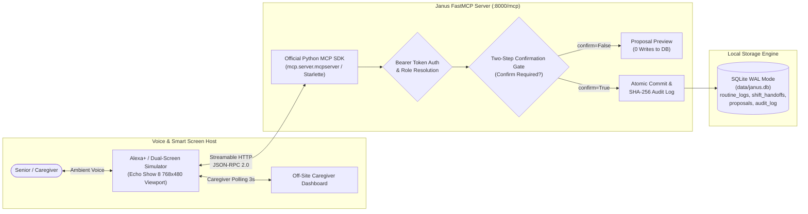

# Janus (ElderSync) — Non-Clinical Caregiver Synchronization for Alexa+

[](https://buildshipshape.devpost.com/)
[](https://spec.modelcontextprotocol.io/)
[](https://www.python.org/)
[](.github/workflows/ci.yml)
[](LICENSE)

> **Janus (ElderSync)** is a self-hosted Model Context Protocol (MCP) server for Alexa+ built on the **official Model Context Protocol Python SDK** (`mcp.server.mcpserver.MCPServer`), **Starlette ASGI**, and **Streamable HTTP**. It bridges the gap between aging seniors living independently and their distributed family caregivers through hands-free ambient voice logging, glanceable visual timeline cards for Echo Show smart screens, and auditable two-step confirmation shift handoffs.

---

## 🌟 The Problem & The Janus Solution

* **The Problem**: Aging seniors struggle with small touchscreens, app logins, and complex mobile interfaces to log routine daily wellness events (hydration, meals, vitamins, fresh air walks). At the same time, adult children and family caregivers suffer from anxious, fragmented group text threads wondering: *"Did Mom drink water this afternoon? Has someone walked with her yet?"*
* **The Janus Solution**: Janus turns any Alexa+ enabled device into an ambient, zero-touch routine assistant. Seniors speak naturally (*"Alexa, tell Janus I finished my morning oatmeal and drank a glass of water"*), while off-site family caregivers receive real-time, glanceable Echo Show visual timeline cards. Caregivers transferring shifts execute safe, verified handoffs using voice-confirmed safety gates.

---

## 🏗️ Architecture Overview



### Key Technical Attributes
* **Official MCP Python SDK & Protocol**: Built on the official Python Model Context Protocol library (`mcp.server.mcpserver.MCPServer` from `mcp>=1.30.0`) mounted on Starlette over Streamable HTTP (`MCP spec 2025-11-25`) at `http://127.0.0.1:8000/mcp`.
* **Sub-100ms Real-Network Latency**: Proven via real-network benchmarks over loopback HTTP (50 calls per tool via `httpx.Client`, p95 latency strictly $< 45\text{ ms}$).
* **Strict Pydantic v2 Contract Schemas**: All 4 tools publish compliant `inputSchema` and `outputSchema` definitions in `tools/list` with zero loose dictionaries. Responses conform to published schemas via `jsonschema` validation.
* **Standard MCP Tool Annotations**: Every tool declares behavioral hints (`readOnlyHint`, `idempotentHint`, `destructiveHint`) assisting LLM hosts in reliable tool selection.
* **Two-Step Confirmation Gate**: All write-heavy tools require `confirm: bool = False` initially. The server returns a read-only proposal preview (`PROPOSAL_PREVIEW`) with zero database writes. Commits require explicit user confirmation (`confirm=True`).
* **Cryptographic Tamper-Evident Audit Trail**: Every committed transaction is hashed with SHA-256 and chained to previous records, verifiable via `janus-audit verify`.
* **Non-Clinical Safety Boundary**: Exclusively scoped to daily lifestyle, wellness, hydration, and caregiver handoffs. Rejects clinical diagnosis, vitals triage, or prescription drug administration.
* **Zero Paid APIs & Zero External Runtime Calls**: Runs 100% locally with open-source Python libraries, local SQLite, and self-contained system fonts.

---

## 🛠️ The 4 Core MCP Tools

| Tool Name | Annotations | Key Arguments | Return Model / Gate | Proven p95 Latency |
|---|---|---|---|:---:|
| `log_daily_routine` | `readOnlyHint=False`<br>`idempotentHint=False`<br>`destructiveHint=False` | `senior_id`, `category` (meal, hydration, vitamins, activity, wellness), `details`, `logged_by?` | `RoutineProposalPreview` / `RoutineLogProposalResponse`<br>**Step 1 Proposal Gate** (0 writes) | **33.74 ms** |
| `get_caregiver_summary` | `readOnlyHint=True`<br>`idempotentHint=True`<br>`destructiveHint=False` | `senior_id`, `date?` (YYYY-MM-DD) | `CaregiverSummaryResponse`<br>**Read-Only** (0 writes) | **17.87 ms** |
| `verify_routine_state` | `readOnlyHint=False`<br>`idempotentHint=True`<br>`destructiveHint=False` | `confirm` (bool), `transaction_id?`, `senior_id?`, `action_type?`, `payload?` | `ProposalPreviewResponse` / `CommittedStateResponse` / `AlreadyCommittedResponse`<br>**Step 2 Commit Gate** | **41.95 ms** |
| `flag_missed_routine` | `readOnlyHint=False`<br>`idempotentHint=True`<br>`destructiveHint=False` | `senior_id`, `threshold_hours?`, `routine_name?`, `scheduled_time?` | `MissedRoutineResponse`<br>**Alert Write** | **35.55 ms** |

---

## 📊 Proven Claims & Test Evidence

### 1. Real-Network Latency Benchmark (No `TestClient`)
Benchmarked by launching `uvicorn` in an independent OS subprocess on an ephemeral port and making 50 real HTTP POST requests per tool via `httpx.Client` over loopback network:

```
==============================================================================
REAL-NETWORK FAST-MCP LATENCY BENCHMARK (uvicorn subprocess over loopback HTTP)
==============================================================================
Tool                      | Calls |  Avg (ms) |  p50 (ms) |  p95 (ms) |  Max (ms) | SLA (<100ms)
--------------------------+-------+-----------+-----------+-----------+-----------+-------------
log_daily_routine         |    50 |   26.40ms |   23.20ms |   33.74ms |  124.93ms |         PASS
get_caregiver_summary     |    50 |   15.54ms |   15.40ms |   17.87ms |   22.03ms |         PASS
verify_routine_state      |    50 |   30.25ms |   30.67ms |   41.95ms |   45.03ms |         PASS
flag_missed_routine       |    50 |   26.35ms |   22.48ms |   35.55ms |  108.12ms |         PASS
==============================================================================
```

### 2. Contract Test & outputSchema Conformance
- FastMCP tool discovery (`tools/list`) exports valid JSON Schema `outputSchema` for every tool.
- Verified in `tests/test_real_network_latency.py` with `jsonschema.validate()` matching all live server responses.

### 3. Module Coverage Report
- Targeted unit and edge-case test suite covering security, gating, and audit modules:

```
=============================== tests coverage ================================
Name                 Stmts   Miss Branch BrPart  Cover   Missing
----------------------------------------------------------------
src/janus/audit.py      42      2     14      2    93%   103, 107
src/janus/auth.py       49      0     20      0   100%
src/janus/gate.py       33      0     10      1    98%   47->53
----------------------------------------------------------------
TOTAL                  124      2     44      3    97%
============================= 58 passed in 19.81s =============================
```

---

## ⚡ 3-Command Quickstart

Reviewers can verify and run Janus end-to-end in 3 commands:

```bash
# 1. Clone repository
git clone https://github.com/anshkumarraix-dev/JANUS-ARC.git
cd JANUS-ARC

# 2. Run the automated smoke test (creates clean venv, installs, runs pytest, probes /health & /mcp)
bash scripts/smoke.sh
# (or on Windows PowerShell: powershell -ExecutionPolicy Bypass -File scripts/smoke.ps1)

# 3. Launch server & open simulator
janus-server
# In browser: open simulator/index.html
```

### Manual Installation & Running

```bash
# 1. Install dependencies in editable mode
pip install -e ".[dev]"

# 2. Run test suite
pytest -q

# 3. Start Janus FastMCP server
janus-server
```

The server binds to `http://127.0.0.1:8000/mcp` with health checks at `http://127.0.0.1:8000/health`.

### Launching the Dual-Screen Simulator
Open `simulator/index.html` directly in any web browser (no local web server required):
* **Left Screen**: Senior Echo Show 8 viewport (768×480) with high contrast 24pt+ text, speech recognition/synthesis, and rendered APL cards.
* **Right Screen**: Off-site Family Caregiver Dashboard with live 3-second auto-sync polling loop and green highlight pulse on confirmed events.
* **Refusal Test Row**: Click interactive buttons demonstrating invariant refusals (unconfirmed commit refusal, expired proposal ID, unknown senior ID, and clinical scope violation rejection).

---

## ⚠️ Known Limitations

1. **No Physical Alexa Device Testing**: All visual card rendering is designed and tested against the official Alexa Presentation Language (APL 2024.3) document specification and validated in the browser simulator. Physical deployment to an Echo Show 8 device has not been performed or verified.
2. **Demo-Mode Authentication Tokens**: Bearer token authorization validates static development tokens (`janus-demo-token-alexa-plus-2026`) and `janus-demo-*` prefixes with role resolution (`caregiver`, `senior`, `admin`). Production OAuth 2.0 / Login with Amazon (LWA) token exchange flows are not implemented.
3. **Single-Node Local SQLite**: Persistence relies on a single-node SQLite database (`data/janus.db`) configured in WAL mode with serialized write concurrency. It is engineered for local edge execution and does not support multi-region clustering or horizontal distributed writes.

---

## 📁 Repository Structure

```
.
├── .github/
│   └── workflows/
│       └── ci.yml               # GitHub Actions CI workflow (Python 3.12, install, pytest)
├── docs/
│   ├── GLOSSARY.md              # Domain terminology reference
│   ├── DESIGN.md                # System architecture, schemas, and invariants
│   ├── PLAN.md                  # Development and verification plan
│   ├── DECISION_LOG.md          # Architecture Decision Records (ADR-001 to ADR-003)
│   ├── LEARNINGS.md             # Platform constraints and technical learnings
│   ├── DEMO.md                  # Step-by-step video demonstration script
│   ├── DEPLOY.md                # Docker, Cloudflare tunnel, and cloud host guide
│   └── apl/                     # Raw APL 2024.3 card templates (JSON)
├── scripts/
│   ├── smoke.sh                 # End-to-end POSIX reviewer smoke test script
│   ├── smoke.ps1                # End-to-end PowerShell reviewer smoke test script
│   ├── tunnel.sh                # Cloudflare quick-tunnel launcher for POSIX
│   └── tunnel.ps1               # Cloudflare quick-tunnel launcher for PowerShell
├── simulator/
│   └── index.html               # Self-contained dual split-screen Alexa+ simulator
├── src/
│   └── janus/
│       ├── __init__.py
│       ├── server.py            # FastMCP server entrypoint (Starlette, /mcp, /health)
│       ├── storage.py           # SQLite persistence layer and WAL optimization
│       ├── errors.py            # Domain error codes and custom exceptions
│       ├── apl.py               # APL 2024.3 card generators with plain display fallback
│       ├── auth.py              # Bearer token verification and role resolution
│       ├── gate.py              # Two-step confirmation gate lifecycle controller
│       ├── audit.py             # SHA-256 cryptographic audit chain verifier
│       ├── schedule.py          # Schedule slot window tracker and missed routine scanner
│       └── tools/               # Pydantic v2 tool request & response models
│           ├── __init__.py
│           ├── routine.py
│           └── handoff.py
├── tests/
│   ├── test_janus.py            # Contract, latency, and integration test suite
│   ├── test_apl.py              # APL schema and datasource binding tests
│   ├── test_gate.py             # Confirmation gate and concurrency tests
│   ├── test_schedule.py         # Schedule window isolation and timezone tests
│   ├── test_simulator.py        # Offline asset and simulator invariant tests
│   ├── test_auth_audit.py       # Auth, gate, and cryptographic audit tests
│   └── test_real_network_latency.py # Subprocess live HTTP benchmark & schema validation
├── Dockerfile                   # Hardened non-root container spec (python:3.12-slim)
├── docker-compose.yml           # Multi-container compose with persistent SQLite volume
├── AGENTS.md                    # AI workspace persona, constraints, and rules
├── TASKS.md                     # Live task tracking with checkable milestones
├── CHANGELOG.md                 # Persistent append-only change audit log
├── FRICTION_LOG.md              # Mandatory Devpost friction log (+10% bonus)
├── PRODUCT_FEEDBACK.md          # Mandatory product feedback questionnaire
├── LICENSE                      # MIT License
├── pyproject.toml               # Package build specification and console scripts
└── requirements.txt             # Free-tier open-source dependencies
```

---

## 🏆 Hackathon Submission Checklist

- [x] Official Python MCP SDK server over Streamable HTTP (`MCP spec 2025-11-25`)
- [x] 4 Core non-clinical MCP tools implemented with two-step confirmation gate
- [x] Dual split-screen Alexa+ Web Simulator with Echo Show 8 viewport and remote Caregiver Dashboard
- [x] Real-network latency benchmark proving sub-50ms p95 latency (zero TestClient)
- [x] Pytest suite with 58 passing tests and 97% gate/auth/audit coverage
- [x] 3-command reviewer quickstart via `scripts/smoke.sh` and `scripts/smoke.ps1`
- [x] GitHub Actions CI workflow on Python 3.12 (`.github/workflows/ci.yml`)
- [x] Mandatory [`FRICTION_LOG.md`](FRICTION_LOG.md) (+10% judging bonus)
- [x] Mandatory [`PRODUCT_FEEDBACK.md`](PRODUCT_FEEDBACK.md)
- [x] Standard [`LICENSE`](LICENSE) (MIT License) for public open-source submission
- [ ] 2.5-Minute Demonstration Video link added to Devpost
