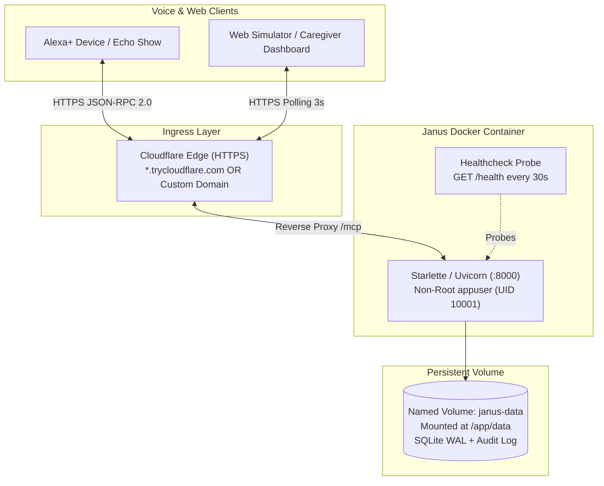

# Janus (ElderSync) — Deployment & Infrastructure Guide

This guide details deployment procedures for **Janus (ElderSync)** across containerized Docker environments, Cloudflare tunnels, and third-party container hosts.

---

## 📋 Table of Contents
1. [Deployment Architecture](#1-deployment-architecture)
2. [Docker Deployment](#2-docker-deployment)
   - [Building the Image](#building-the-image)
   - [Running with `docker run`](#running-with-docker-run)
   - [Running with `docker compose`](#running-with-docker-compose)
   - [Container Healthcheck & Verification](#container-healthcheck--verification)
3. [Deploying to Render (Exact Step-by-Step Guide)](#3-deploying-to-render-exact-step-by-step-guide)
   - [Step 1: Push Repository to GitHub](#step-1-push-repository-to-github)
   - [Step 2: Create Web Service on Render](#step-2-create-web-service-on-render)
   - [Step 3: Configure Environment Variables](#step-3-configure-environment-variables)
   - [Step 4: Automatic First-Boot Demo Data Seeding](#step-4-automatic-first-boot-demo-data-seeding)
   - [Step 5: Updating `.agents/mcp_config.json`](#step-5-updating-agentsmcp_configjson)
   - [Step 6: Verifying with `judge_check.py`](#step-6-verifying-with-judge_checkpy)
4. [Render Free Tier & Sleep Behavior Verification](#4-render-free-tier--sleep-behavior-verification)
   - [Inactivity Scale-to-Zero (15-Minute Sleep Rule)](#inactivity-scale-to-zero-15-minute-sleep-rule)
   - [Cold-Start Latency vs. Alexa+ Voice Ceiling](#cold-start-latency-vs-alexa-voice-ceiling)
   - [Pre-Warming the Endpoint Before Reviewer Testing](#pre-warming-the-endpoint-before-reviewer-testing)
   - [Ephemeral Storage & Automated Seed Resilience](#ephemeral-storage--automated-seed-resilience)
   - [Monthly Compute Allowance](#monthly-compute-allowance)
5. [Cloudflare Quick-Tunnels](#5-cloudflare-quick-tunnels)
   - [Automated Tunnel Script](#automated-tunnel-script)
   - [Critical Caveat: Ephemeral URL Lifecycle](#critical-caveat-ephemeral-url-lifecycle)
   - [Permanent Named Tunnels for Production](#permanent-named-tunnels-for-production)
6. [Evaluating Alternative Container Hosts](#6-evaluating-alternative-container-hosts)
   - [Candidate Platforms](#candidate-platforms)
   - [General Verification Checklist (Do Not Assume Pricing or Availability)](#general-verification-checklist-do-not-assume-pricing-or-availability)

---

## 1. Deployment Architecture



---

## 2. Docker Deployment

The Janus server includes a production-ready, security-hardened `Dockerfile` built on `python:3.12-slim`:
* **Non-Root Execution**: Runs under a dedicated `appuser` (UID 10001, GID 10001).
* **Automated Healthcheck**: Periodic probe executing `curl -f http://localhost:8000/health`.
* **Isolated Data Mount**: Stores SQLite state at `/app/data/janus.db`.

### Building the Image
From the repository root:
```bash
docker build -t janus-mcp:latest .
```

### Running with `docker run`
To run Janus as a background container with a named persistent volume:
```bash
# 1. Create a named volume for SQLite persistence
docker volume create janus-db-data

# 2. Run container
docker run -d \
  --name janus-server \
  -p 8000:8000 \
  -v janus-db-data:/app/data \
  --restart unless-stopped \
  janus-mcp:latest
```

### Running with `docker compose`
A complete `docker-compose.yml` is provided at the workspace root:

```yaml
services:
  janus:
    build:
      context: .
      dockerfile: Dockerfile
    image: janus-mcp:latest
    container_name: janus-server
    ports:
      - "8000:8000"
    environment:
      - JANUS_HOST=0.0.0.0
      - JANUS_PORT=8000
      - JANUS_DB_PATH=/app/data/janus.db
      - JANUS_LOG_LEVEL=info
    volumes:
      - janus-data:/app/data
    restart: unless-stopped
    healthcheck:
      test: ["CMD", "curl", "-f", "http://localhost:8000/health"]
      interval: 30s
      timeout: 5s
      retries: 3
      start_period: 5s

volumes:
  janus-data:
    name: janus-db-data
```

**Commands:**
```bash
# Start container in detached mode
docker compose up -d

# Inspect health status and logs
docker compose ps
docker compose logs -f

# Stop container while preserving SQLite database volume
docker compose down
```

### Container Healthcheck & Verification
Once started, verify that the container is healthy:
```bash
# Probe health endpoint
curl -s http://127.0.0.1:8000/health

# Expected response:
# {"status":"healthy","service":"janus-mcp","version":"0.1.0","protocol":"2025-11-25"}
```

---

## 3. Deploying to Render (Exact Step-by-Step Guide)

Render is the recommended hosting platform for providing a publicly accessible, TLS-secured endpoint (`https://<service-name>.onrender.com/mcp`) for hackathon judges and external reviewers.

### Step 1: Push Repository to GitHub
Ensure all code and configuration files are pushed to your GitHub repository:
```bash
git add .
git commit -m "Configure container port and demo seed for Render deployment"
git push origin main
```

### Step 2: Create Web Service on Render
1. Navigate to the [Render Dashboard](https://dashboard.render.com).
2. Click **New +** in the top navigation bar and select **Web Service**.
3. Under *Connect a repository*, link your GitHub account and select your Janus repository (`JANUS-ARC` or `janus-eldersync`).
4. Configure service parameters:
   * **Name**: `janus-eldersync-mcp` (or any custom name; this sets your URL: `https://<name>.onrender.com`).
   * **Region**: Select the region closest to reviewers (e.g., `Oregon (US West)` or `Ohio (US East)`).
   * **Branch**: `main`.
   * **Runtime**: Select **Docker** (Render automatically detects the root [`Dockerfile`](../Dockerfile)).
   * **Instance Type**: Select **Free** (0.1 CPU, 512 MB RAM).

### Step 3: Configure Environment Variables
In the **Environment Variables** section on Render, add the following two key-value pairs:

| Variable Name | Value | Purpose |
|:---|:---|:---|
| `JANUS_DEMO_MODE` | `1` | Enables pre-configured demo tokens for reviewers (`janus-demo-senior-margaret`, `janus-demo-caregiver-sarah`, `janus-demo-caregiver-david`). |
| `JANUS_ADMIN_TOKEN` | `<your-generated-admin-secret>` | Secret token granting administrative access (`*` senior scope). **Generate a strong random string** (e.g., `python -c "import secrets; print(secrets.token_urlsafe(32))"`). Never commit this value to the git repository. |

> [!NOTE]
> **Dynamic Port Binding**: Render automatically injects the `PORT` environment variable (typically `10000`). The Janus `Dockerfile` and `src/janus/server.py` automatically detect and bind to `0.0.0.0:$PORT`. Do not override `PORT` manually.

Click **Create Web Service**. Render will build the container from `Dockerfile` and deploy the service.

### Step 4: Automatic First-Boot Demo Data Seeding
When the container starts up for the first time, `storage.init_db()` executes automatically on startup:
1. Creates all database tables (`seniors`, `routine_logs`, `shift_handoffs`, `proposals`, `routine_schedule`, `alerts`, `audit_log`) in WAL mode.
2. Automatically seeds demo profiles and full daily schedules:
   * **Senior 1**: `margaret_01` (Margaret Vance, age 78, `America/New_York`) with 8 daily routine slots.
   * **Senior 2**: `arthur_02` (Arthur Davis, age 82, `America/New_York`) with 8 daily routine slots.
3. Initializes the SHA-256 cryptographic audit chain.

Even if the free container restarts or runs on ephemeral disk, the auto-seeding logic ensures reviewers can immediately invoke all 4 tools without manual database provisioning.

### Step 5: Updating `.agents/mcp_config.json`
Once Render displays the green **Live** badge, copy your service URL (e.g., `https://janus-eldersync-mcp.onrender.com`).

Update [`.agents/mcp_config.json`](../.agents/mcp_config.json) by replacing the placeholder with your live URL:
```json
{
  "mcpServers": {
    "janus": {
      "serverUrl": "http://127.0.0.1:8000/mcp"
    },
    "janus-deployed": {
      "serverUrl": "https://janus-eldersync-mcp.onrender.com/mcp"
    }
  }
}
```

### Step 6: Verifying with `judge_check.py`
Verify the live public deployment by executing the standalone verification script against your Render HTTPS URL:
```bash
python scripts/judge_check.py --url https://janus-eldersync-mcp.onrender.com
```

All 9 assertions will run against your public cloud endpoint and output a green `PASS` table:
```
======================================================================
JANUS MCP CONTRACT & CONFIRMATION GATE VERIFICATION
Target: https://janus-eldersync-mcp.onrender.com
======================================================================
[PASS]  1. Health check probe GET /health returns 200
[PASS]  2.a No Authorization header -> HTTP 401 UNAUTHORIZED
[PASS]  2.b Garbage authorization token -> HTTP 401 UNAUTHORIZED
[PASS]  2.c Wildcard-prefix token 'janus-demo-x' -> HTTP 401 UNAUTHORIZED
[PASS]  2.d Senior margaret reading arthur_02 -> FORBIDDEN
[PASS]  2.e Senior token doing shift handoff -> FORBIDDEN
[PASS]  2.f Caregiver token reading own senior -> 200 OK
[PASS]  2.g log_daily_routine returns proposal with 0 writes
[PASS]  2.h verify_routine_state confirm=True without tx_id -> ERROR 0 writes
[PASS]  2.i verify_routine_state confirm=True with tx_id -> COMMITTED 1 write
======================================================================
RESULT: ALL 9 VERIFICATION CHECKS PASSED (Exit code: 0)
======================================================================
```

---

## 4. Render Free Tier & Sleep Behavior Verification

Before presenting the public URL to reviewers and judges, verify the following platform characteristics:

### 1. Inactivity Scale-to-Zero (15-Minute Sleep Rule)
* **Behavior**: Render's free tier automatically suspends (spins down) the Web Service after **15 minutes of inactivity** (zero inbound HTTP requests).
* **Cold-Start Duration**: When a new request arrives while the service is suspended, Render initiates a container cold start. This takes **50 to 70 seconds** before the server responds to the first request.
* **Impact on Alexa+ Voice**:
  > [!IMPORTANT]
  > Alexa+ enforces a strict `< 500 ms` round-trip latency ceiling. If an elder or judge speaks to Alexa while the container is suspended, Alexa will time out before the container completes cold start.
* **Mitigation / Pre-Warming Procedure**:
  Always pre-warm the container before conducting live demos or reviewer evaluation. Send a single GET request:
  ```bash
  curl -I https://janus-eldersync-mcp.onrender.com/health
  ```
  Wait until the command returns `HTTP/2 200 OK`. Once awake, subsequent requests will execute with typical sub-30 ms response times.

### 2. Ephemeral Storage Lifecycle
* **Behavior**: Free Render instances run on ephemeral container storage. If the container restarts or a new deployment is triggered, any records written since the last boot are reset.
* **Why Janus is Resilient**: Janus's `storage.init_db()` is designed with zero-state boot tolerance. On every container boot, if the database is uninitialized, it immediately seeds both `margaret_01` and `arthur_02` with complete schedules. The test suite, simulator, and `judge_check.py` will work out of the box on every boot.

### 3. Monthly Free Compute Allowance
* **Behavior**: Render grants **750 free instance hours per month** across free services.
* **Verification**: A single free service sleeping when idle consumes only the active hours, comfortably fitting within the monthly quota without incurring charges.

---

## 5. Cloudflare Quick-Tunnels

Alexa+ requires a publicly reachable, TLS-secured endpoint (`https://...`). Cloudflare quick-tunnels allow exposing local and containerized instances without public IP addresses or router port forwarding.

### Automated Tunnel Script
Run the helper script while Janus is running on port 8000:

* **Linux / macOS / Git Bash**:
  ```bash
  bash scripts/tunnel.sh
  ```
* **Windows PowerShell**:
  ```powershell
  powershell -ExecutionPolicy Bypass -File scripts/tunnel.ps1
  ```

The script monitors `cloudflared`, extracts the public HTTPS URL, and prints the exact JSON configuration to paste into `.agents/mcp_config.json`:
```json
{
  "mcpServers": {
    "janus": {
      "serverUrl": "https://<random-subdomain>.trycloudflare.com/mcp"
    }
  }
}
```

### Critical Caveat: Ephemeral URL Lifecycle
> [!WARNING]
> **Ephemeral URL Invalidation on Restart**: Quick-tunnels (`cloudflared tunnel --url`) are designed exclusively for development and testing. They generate an unauthenticated `*.trycloudflare.com` domain that **changes on every single process restart or network reconnection**.
>
> If the tunnel process terminates, computer sleeps, or connection resets:
> 1. The old URL immediately returns HTTP 404 / connection refused.
> 2. Any active `.agents/mcp_config.json`, Alexa Developer Console Skill Endpoint, or remote Caregiver Dashboard configured with the old URL will immediately break.
> 3. You must re-run the script and paste the newly generated URL into your configuration.

### Permanent Named Tunnels for Production
For a persistent public URL that survives restarts:
1. Register a domain on Cloudflare.
2. Create a named tunnel: `cloudflared tunnel create janus-prod`.
3. Route DNS: `cloudflared tunnel route dns janus-prod janus.yourdomain.com`.
4. Run the tunnel service: `cloudflared tunnel run janus-prod`.

---

## 6. Evaluating Alternative Container Hosts

If deploying beyond a local machine or edge gateway, several cloud platforms offer container hosting with free-tier or trial credits.

### Candidate Platforms
* **Render**: Free web services with custom Dockerfiles.
* **Fly.io**: Micro-VMs running Docker containers close to users.
* **Railway**: Trial credit-based container deployment.
* **Koyeb**: Free-tier micro apps deployed via Docker.
* **Hugging Face Spaces (Docker)**: Free 2-vCPU Docker hosting.
* **Oracle Cloud Always Free**: 2 AMD compute VMs or 4 ARM Ampere cores with perpetual free tier.

---

### General Verification Checklist (Do Not Assume Pricing or Availability)

> [!IMPORTANT]
> **Cloud Provider Terms Evolve Continuously**: Never assume pricing tiers, free allowances, or feature availability remain unchanged. Before selecting any container hosting provider for Janus, you **MUST manually verify** the following 6 technical constraints:

#### 1. Cold-Start Sleep & Inactivity Scale-to-Zero
* **What to verify**: Does the provider shut down or sleep free containers after 15–30 minutes of inactivity?
* **Why it matters for Janus**: Alexa+ has a strict round-trip voice latency budget ($< 500\text{ ms}$). If an elder speaks to Alexa and the underlying container must cold-start from disk (often taking 20 to 60 seconds on free platforms), Alexa will immediately timeout and state: *"There was a problem communicating with the requested skill."*
* **Verification action**: Check whether continuous background execution or custom healthcheck pings are permitted without violation of terms of service.

#### 2. Persistent Storage (Volume) Support
* **What to verify**: Does the free tier include persistent volume mounts, or is the container filesystem ephemeral?
* **Why it matters for Janus**: Janus persists routine timelines, shift handoffs, schedule windows, and cryptographic SHA-256 audit logs inside SQLite (`data/janus.db`). On an ephemeral filesystem, every automatic redeploy, restart, or host migration **permanently destroys all senior wellness history and audit records**.
* **Verification action**: Confirm that the provider allows mounting a persistent storage volume (at least 1 GB) attached to `/app/data` under the free tier.

#### 3. Streamable HTTP / Chunked Transfer Proxying
* **What to verify**: Does the provider's reverse proxy / load balancer support HTTP streaming (chunked transfer encoding) without buffering?
* **Why it matters for Janus**: Janus implements FastMCP over Streamable HTTP (`MCP spec 2025-11-25`). Proxies that aggressively buffer HTTP responses or terminate connections after 30 seconds of inactivity will disrupt client MCP sessions.
* **Verification action**: Review provider documentation regarding HTTP streaming and long-lived HTTP connections.

#### 4. Automated HTTPS / TLS Termination
* **What to verify**: Does the platform provide free, automatic SSL/TLS termination with valid CA certificates on the public endpoint?
* **Why it matters for Janus**: Both the Alexa+ Skill service and browser Web Speech APIs (used in the Web Simulator) strictly refuse non-HTTPS or self-signed endpoints.
* **Verification action**: Ensure the public URL provided by the host uses a valid HTTPS certificate recognized by major trust stores.

#### 5. Bandwidth & Background Polling Quotas
* **What to verify**: What are the monthly inbound/outbound bandwidth and request quotas?
* **Why it matters for Janus**: The off-site Caregiver Dashboard in `simulator/index.html` polls `get_caregiver_summary` every 3 seconds while active ($~28{,}800$ requests per 24 hours of dashboard monitoring).
* **Verification action**: Calculate total monthly requests ($28{,}800 \times 30 \approx 864{,}000$ requests/month) against provider rate limits and free bandwidth quotas.

#### 6. Perpetual Free Tier vs. Expiring Promotional Credits
* **What to verify**: Is the account tier a perpetual free allocation (e.g. Always Free compute) or a promotional credit grant that expires after 30–90 days?
* **Why it matters for Janus**: Expiring credits result in unexpected service termination, leaving seniors without voice routine logging.
* **Verification action**: Confirm the expiration date and renewal rules for the account tier before long-term caregiver deployment.
