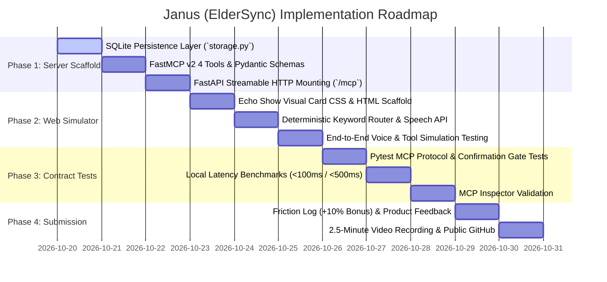

# ElderSync / Janus — Phased Implementation Roadmap (PLAN.md)

This document outlines the phased build strategy for **Janus (ElderSync)** for the *Build, Ship, Shape: Amazon Developer Hackathon (Alexa+ Track)*.

---

## Roadmap Overview

---

## Phase Details

### Phase 1: Server Scaffold & Storage Engine
* **Objective**: Build a production-grade, self-hosted FastMCP v2 server over Streamable HTTP (`MCP spec 2025-11-25`).
* **Key Tasks**:
  1. Initialize SQLite persistence in `src/janus/storage.py` with tables `routine_logs` and `shift_handoffs`.
  2. Implement typed Pydantic models for inputs, outputs, and Echo Show visual card payloads in `src/janus/tools/`.
  3. Register 4 core MCP tools in `src/janus/server.py`:
     - `log_daily_routine`
     - `get_caregiver_summary`
     - `verify_routine_state`
     - `flag_missed_routine`
  4. Mount Streamable HTTP transport on FastAPI at `http://127.0.0.1:8000/mcp`.
  5. Validate two-step confirmation gate logic (`confirm=False` preview vs `confirm=True` write).

### Phase 2: Web Simulator & Echo Show Visual Card Renderer
* **Objective**: Provide an interactive smart screen simulator matching Echo Show viewports.
* **Key Tasks**:
  1. Build `simulator/index.html` with responsive Echo Show card styling (dark modern UI, arm's-length high contrast typography).
  2. Implement browser voice interaction via Web Speech API (`webkitSpeechRecognition` / `speechSynthesis`).
  3. Add robust typed text input fallback to bypass sandboxed iframe `Origin: null` restrictions.
  4. Build a local deterministic keyword router mapping senior/caregiver phrases to `/mcp` tool execution in $< 5\text{ ms}$ with zero API costs.
  5. Render real-time visual timeline cards upon receiving MCP tool outputs.

### Phase 3: Contract Testing & Latency Benchmarks
* **Objective**: Enforce strict MCP contract compliance, confirmation safety, and sub-100 ms local execution.
* **Key Tasks**:
  1. Write automated test suite in `tests/test_janus.py` using `pytest` and `httpx`.
  2. Verify JSON-RPC 2.0 request/response structures according to `MCP spec 2025-11-25`.
  3. Test confirmation gates: assert that calling write tools with `confirm=False` executes zero database mutations.
  4. Benchmark execution latency across 100 consecutive tool invocations: assert local execution $< 100\text{ ms}$ (p95) and total round-trip $< 500\text{ ms}$.
  5. Verify tool schema listing and discovery via `@modelcontextprotocol/inspector`.

### Phase 4: Video Demo, Documentation & Submission
* **Objective**: Complete all mandatory Amazon Developer Hackathon submission requirements.
* **Key Tasks**:
  1. Pre-fill and verify Devpost submission documentation:
     - [`README.md`](file:///c:/Users/Lenovo/Downloads/JANUS%20ARC/README.md) with architectural overview and setup steps.
     - [`FRICTION_LOG.md`](file:///c:/Users/Lenovo/Downloads/JANUS%20ARC/FRICTION_LOG.md) (+10% judging bonus).
     - [`PRODUCT_FEEDBACK.md`](file:///c:/Users/Lenovo/Downloads/JANUS%20ARC/PRODUCT_FEEDBACK.md) answering all questionnaire items.
     - [`LICENSE`](file:///c:/Users/Lenovo/Downloads/JANUS%20ARC/LICENSE) (MIT License).
  2. Record a 2.5-minute video demo demonstrating the three key user journeys:
     - Senior ambient voice logging of hydration/meals.
     - Caregiver visual daily summary on Echo Show card.
     - Two-step shift handoff verification and confirmation.
  3. Validate public GitHub repository readiness.
